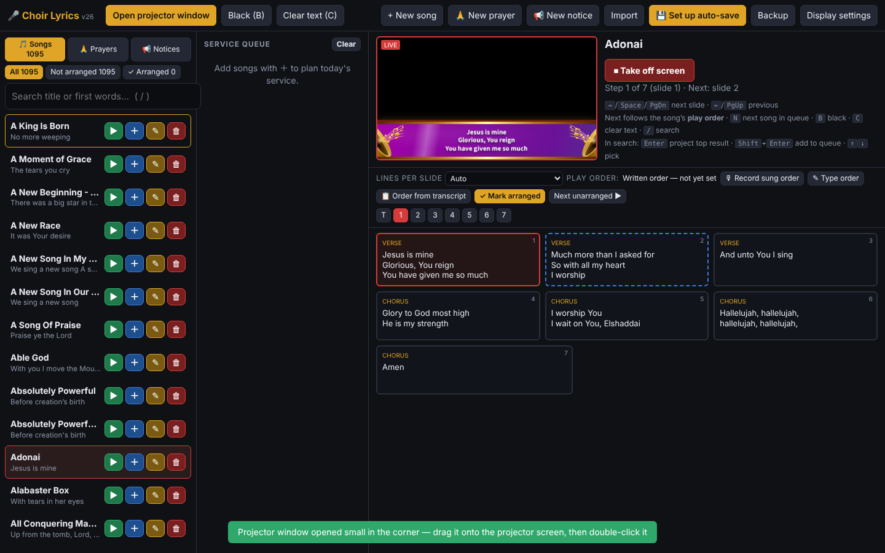
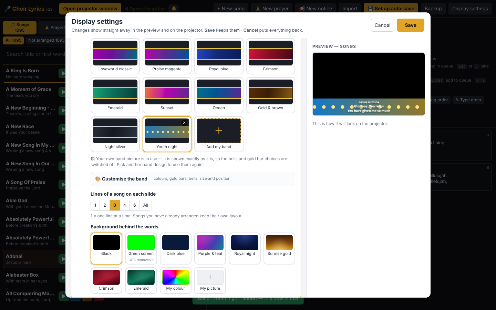
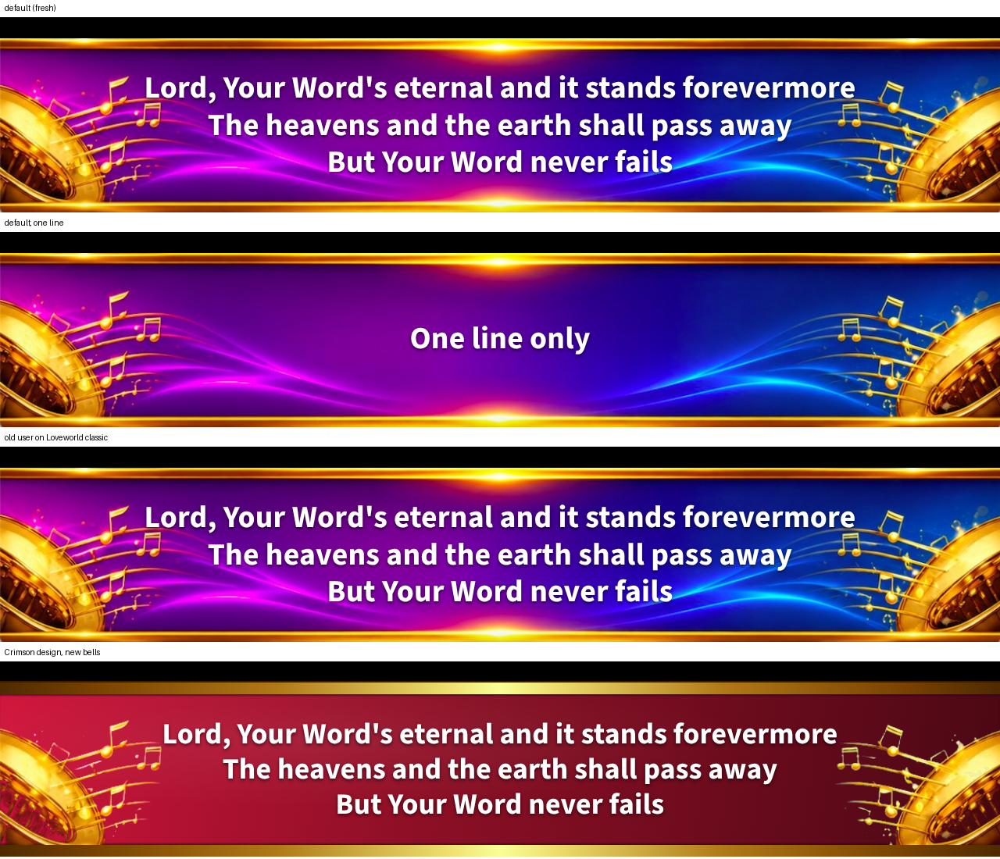

# Loveworld Service Admin App — Choir Lyrics

A simple app for projecting **song lyrics, prayers and notices** during church services. It works alongside **EasyWorship and OBS**, on a projector and an LED screen.

## What it does

- **Find any song fast:** search by title or by the first words, then press Enter to show it.
- **Plan the service:** queue songs, prayers and notices for the day and move through them in order.
- **Sung order:** each song can follow the order it is actually sung in (chorus, verse, chorus…), so the operator only presses **Next**.
- **Loveworld band look:** the Loveworld purple-and-blue band with gold bars, bells and music notes as the default, plus other band designs, your own band picture, backgrounds and saved looks.
- **Prayers:** one paragraph per slide. **Notices:** slide across the screen one sentence at a time.
- **Made for OBS:** *Take off screen* turns the output pure green, so OBS shows only the camera, and the band stays the same size on every slide so it always lines up in your scene.
- **Never lose work:** every change is saved automatically to a folder (for example Google Drive).
- **Works offline:** a single file that opens in Google Chrome or Microsoft Edge, with nothing to install.

*The default Loveworld band (it keeps one size whether a slide has 1 line or 3), and one of the other designs:*

## Getting the app

The app and the song library are kept in a **private** repository, because the song lyrics are for church use only.

**To request access:**

1. Click the **Issues** tab above → **New issue** → **Request access**.
2. Fill in your name, church or fellowship, and how you will use the app.
3. You will be added to the private repository, or receive the files directly.

> Please note: issues on this page are public, so do not include phone numbers or private details in the request.

## Requirements

- A laptop with **Google Chrome** or **Microsoft Edge**
- A projector or LED screen (optional: OBS for livestreams and overlays)
